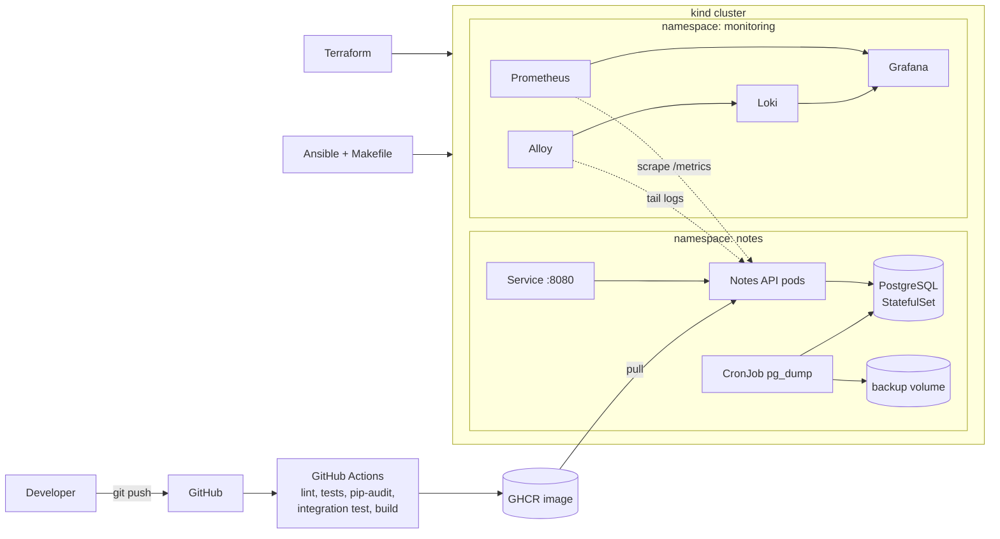

# DevOps-Capstone: End-to-End DevOps Automation Platform

[](../../actions/workflows/ci.yml)


A complete delivery platform around a small Notes application (Python API and PostgreSQL). A single command builds the cluster, the application and the monitoring stack from this repository, and every stage from commit to recovery is automated and tested.

## Architecture



## What it demonstrates

| Capability | Implementation |
|------------|----------------|
| Version control | Git history with small, focused commits |
| CI/CD | GitHub Actions: flake8, pytest, pip-audit gate, Docker Compose integration test, image build and push to GHCR |
| Containers | Slim non-root image, Docker Compose for local runs |
| Orchestration | Kubernetes on kind (3 nodes): probes, resource limits, rolling updates, StatefulSet with persistent volume |
| Infrastructure as code | Terraform creates the cluster, namespaces, Pod Security label and a random database password |
| Configuration management | Idempotent Ansible playbook installs tools, Helm charts and manifests; Makefile gives one-command up and down |
| Monitoring | Prometheus, Grafana, a custom dashboard and three alert rules |
| Logging | Loki with Alloy collecting pod logs, queryable in Grafana |
| Security | Pod Security baseline, read-only filesystem, non-root, dropped capabilities, seccomp, dedicated service account, generated secrets, blocking dependency scan |
| Recoverability | Scheduled pg_dump backups, restore job, self-healing pods, rollback |
| Release strategy | Canary release, promotion by rolling update, rollback of a failed release |

## Repository layout

```text
.
├── .github/workflows/ci.yml      CI pipeline
├── app/                          Flask API, Dockerfile, unit tests
├── k8s/
│   ├── kind-config.yaml          3-node cluster with port mappings
│   ├── 10-postgres.yaml          database StatefulSet and Service
│   ├── 20-app.yaml               ConfigMap, Deployment, Service, ServiceAccount
│   ├── 30-backup.yaml            backup volume and CronJob
│   ├── canary/                   canary Deployment
│   └── recovery/                 restore Job
├── infra/terraform/
│   ├── cluster/                  kind cluster
│   └── platform/                 namespaces, secret, Pod Security label
├── ansible/                      inventory and playbook
├── monitoring/                   Helm values, Loki, Alloy, alerts, dashboard
├── docker-compose.yml            local run and CI integration test
└── Makefile                      up, down, status and stage targets
```

## Quick start

**Requirements:** Docker (running), Terraform, Ansible, make and curl on Linux or WSL2. The playbook installs kind, kubectl and Helm if they are missing.

```bash
git clone <repository-url>
cd DevOps-Capstone
make up
```

`make up` runs four stages in order: tools, cluster (Terraform), platform (Terraform) and deploy (Ansible), then installs monitoring. The first run downloads several images and takes around 10 minutes.

| Service | URL |
|---------|-----|
| Notes app | http://localhost:8080 |
| Grafana | http://localhost:3000 |
| Prometheus | http://localhost:9090 |

Grafana generates its admin password at install time:

```bash
kubectl -n monitoring get secret kube-prometheus-stack-grafana -o jsonpath='{.data.admin-password}' | base64 -d; echo
```

On Linux or WSL the log collector may need higher inotify limits:

```bash
sudo sysctl -w fs.inotify.max_user_instances=512 fs.inotify.max_user_watches=524288
```

| Command | Purpose |
|---------|---------|
| `make up` | Build everything |
| `make down` | Destroy the platform and the cluster |
| `make status` | Show nodes and pods |
| `make deploy` | Re-apply manifests (safe to repeat, reports changed=0 when nothing differs) |
| `make monitoring` | Install or update Prometheus, Grafana, Loki and Alloy |

## How it works

**Pipeline.** Every push runs three jobs in order. Lint and tests (flake8, seven pytest tests, pip-audit), then an integration test that starts the full stack with Docker Compose and creates and reads a note, then a Buildx build that pushes the image to GHCR tagged with the commit SHA. A vulnerable dependency fails the first job and stops the pipeline.

**Infrastructure.** Terraform is split into a cluster configuration and a platform configuration. The platform step generates a random database password and stores it only as a Kubernetes Secret. The Terraform state is git-ignored.

**Deployment.** Ansible applies the manifests, waits for the database and application rollouts and smoke-tests the health endpoint. The API Deployment uses readiness and liveness probes, resource limits, an init container that waits for the database, and a rolling update with no unavailable pods.

**Observability.** Prometheus scrapes the API every 15 seconds. The Notes App dashboard shows request rate per endpoint, p95 latency, pods up and live logs.

| Alert | Condition |
|-------|-----------|
| NotesAppDown | No healthy app pod is being scraped for 1 minute |
| NotesAppHighErrorRate | More than 5 percent of requests fail for 2 minutes |
| NotesAppHighLatency | p95 latency above 1 second for 5 minutes |

**Security.** Pods run as non-root with a read-only root filesystem, no privilege escalation, all capabilities dropped and the default seccomp profile. The app has its own service account with the API token disabled. The notes namespace enforces the Pod Security baseline, so privileged pods are rejected.

## Operations runbook

**Self-healing and scaling**

```bash
kubectl -n notes delete pod <app-pod>          # a replacement starts automatically
kubectl -n notes scale deployment notes-app --replicas=4
```

**Backup and restore.** A CronJob dumps the database every 30 minutes and keeps the last five dumps.

```bash
kubectl -n notes create job --from=cronjob/postgres-backup backup-now
kubectl apply -f k8s/recovery/restore-job.yaml        # restores the newest dump
kubectl -n notes delete job postgres-restore backup-now
```

**Canary release.** The canary shares the Service selector with the stable pods, so traffic splits by pod count. Wait a few seconds after the canary is ready before sampling.

```bash
kubectl apply -f k8s/canary/notes-app-canary.yaml
for i in $(seq 1 40); do curl -s localhost:8080/version; done | sort | uniq -c
```

Promote by updating APP_VERSION in the ConfigMap and running `kubectl -n notes rollout restart deployment/notes-app`, then delete the canary. Roll back a bad release with:

```bash
kubectl -n notes rollout undo deployment/notes-app
kubectl -n notes rollout history deployment/notes-app
```

## Design decisions

- **kind on a laptop.** Free, reproducible and enough to show real multi-node scheduling and self-healing.
- **NodePort instead of an ingress controller.** The widely used ingress-nginx project has been retired, and a port mapping is enough locally.
- **Loki as a plain Deployment with Alloy.** Keeps the logging stack small and independent of chart packaging changes.
- **Canary with plain Kubernetes.** A second Deployment with a shared label gives a canary without a service mesh.
- **Alertmanager disabled.** Alerts are visible in Prometheus; notification routing is future work.

## Lessons learned

- A StatefulSet always reports configured on re-apply, so the playbook counts only created resources to stay idempotent.
- Prometheus renames a clashing scrape label to exported_endpoint, which broke the first dashboard legend.
- An absent series never satisfies sum(up) < 1, so the down alert uses absent(up == 1).
- The Grafana chart now generates a random admin password instead of a fixed default.
- A canary needs a short wait before sampling, and pods need a graceful drain or a few requests fail when one is removed.
- Raising the inotify limits was required before Alloy could tail logs under WSL.

## Limitations and next steps

- Backups are stored inside the same cluster; production would copy them to object storage.
- The canary differs by configuration, not by image. A real release would ship a new image tag from the pipeline.
- No ingress, TLS or network policies yet.
- Add a preStop hook for graceful pod draining, then Alertmanager notifications.
